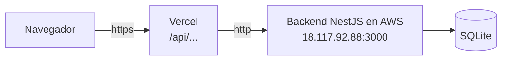

# Jave Parking — Frontend

Frontend de **Jave Parking**, la app del parqueadero de la **Pontificia Universidad Javeriana Cali**. Permite ver qué puestos están libres, registrar la entrada de un carro y cobrar la salida por minuto, conectándose al backend NestJS del proyecto.

**App en línea:** [https://jave-parking-frontend.vercel.app](https://jave-parking-frontend.vercel.app)
**Backend (repositorio):** [mateorivera2410/Jave-Parking](https://github.com/mateorivera2410/Jave-Parking)
**API en AWS:** [http://18.117.92.88:3000/users](http://18.117.92.88:3000/users)

Proyecto del curso **Plataformas Computacionales (2026-2)**.

## Integrantes

- Mateo Rivera Prados
- Diego Alejandro Calvo
- Jan Pieter Lelie
- Carlos Sánchez

## Tecnologías

| Tecnología | Para qué |
|---|---|
| **Next.js 16** (App Router) | Rutas, páginas y rutas dinámicas |
| **React 19** + **TypeScript** | Componentes tipados |
| **Tailwind CSS 4** | Estilos (diseño basado en el prototipo de Figma) |
| **fetch** nativo | Peticiones al backend, sin librerías extra |
| **Vercel** | Despliegue del frontend |

## Cómo se conecta con el backend



- El navegador nunca llama al backend directamente: le pide los datos a Vercel en `/api/...`.
- Vercel los reenvía al backend en AWS (configurado en `next.config.ts` con `rewrites`).
- Así se evita que el navegador bloquee la petición por mezclar **https** (Vercel) con **http** (AWS).
- En el computador (desarrollo), el front llama directo a `http://localhost:3000`.

## Pantallas

| Ruta | Pantalla | Qué hace |
|---|---|---|
| `/` | Inicio | Portada con accesos a cada módulo e integrantes |
| `/parqueaderos` | Puestos | Mapa de puestos (verde = libre, rojo = ocupado), filtro y resumen de cupos |
| `/parqueaderos/[id]` | Detalle del puesto | Estado, tarifa, cambiar tarifa y eliminar |
| `/pagos` | Pagos | Registrar entrada (carro + puesto libre), lista de facturas y filtro por placa |
| `/pagos/[id]` | Pago / Pago exitoso | Tiempo y total hasta ahora, pagar y registrar salida |
| `/carros` | Carros | Registrar carro con su dueño, listar y eliminar |
| `/carros/[placa]` | Historial | Facturas de ese carro |
| `/users` | Usuarios | Crear, listar y desactivar estudiantes |
| `/users/[id]` | Perfil | Datos, si está dentro de la U, sus vehículos y desactivar cuenta |

Las carpetas con corchetes (`[id]`, `[placa]`) son **rutas dinámicas**: el valor de la URL llega como parámetro a la página.

## Flujo principal

1. Se crea el **usuario** (código estudiantil de 8 dígitos).
2. Se registra su **carro** (placa `ABC123`).
3. Se crean los **puestos** con su tarifa por hora.
4. En **Pagos** se registra la **entrada**: la factura queda abierta, el puesto pasa a ocupado y el usuario queda "dentro".
5. Al **pagar y registrar salida**, el backend calcula el total por minuto, libera el puesto y marca al usuario "fuera".

## Estructura (por módulos y componentes)

```
src/
├── app/                         # Rutas (una carpeta = una ruta)
│   ├── layout.tsx               # Header, menú y footer comunes
│   ├── page.tsx                 # Inicio
│   ├── globals.css              # Colores del diseño (tokens de Tailwind)
│   ├── users/                   # /users y /users/[id]
│   ├── carros/                  # /carros y /carros/[placa]
│   ├── parqueaderos/            # /parqueaderos y /parqueaderos/[id]
│   └── pagos/                   # /pagos y /pagos/[id]
├── components/
│   ├── ui/                      # Piezas comunes: botones, tarjeta, placa, estado, íconos, formularios
│   ├── users/                   # UserCard, UserCreateForm, UserAvatar
│   ├── carros/                  # CarroCard, CarroCreateForm
│   ├── parqueaderos/            # ParqueaderoCard, filtros, formulario, DisponibilidadCard
│   ├── pagos/                   # PagoCard, PagoEntradaForm, PagoFilters
│   ├── Nav.tsx                  # Menú (arriba en computador, abajo en celular)
│   └── HomeShortcutCard.tsx
├── modules/                     # Services: el único lugar que habla con el backend
│   ├── users/services/usersService.ts
│   ├── carros/services/carrosService.ts
│   ├── parqueaderos/services/parqueaderosService.ts
│   └── pagos/services/pagosService.ts
├── hooks/useEntityDetail.ts     # Carga reutilizable de un detalle por id
├── lib/
│   ├── api.ts                   # apiClient: fetch base + manejo de errores
│   └── format.ts                # Formatos: pesos, horas, placa, duración
└── types/api.ts                 # Tipos (espejo de las entities del backend)
```

### Si algo falla, dónde buscar

| Si falla… | Se revisa |
|---|---|
| El backend responde error o la ruta está mal | `src/modules/<módulo>/services/` |
| Algo se ve mal (tarjeta, formulario, botón) | `src/components/<módulo>/` |
| La página no carga o no se actualiza | `src/app/<módulo>/page.tsx` |
| Un campo no coincide con el backend | `src/types/api.ts` |
| No conecta con el backend | `.env`, `next.config.ts` o `src/lib/api.ts` |
| Un color o un estilo de botón en toda la app | `src/app/globals.css` o `src/components/ui/buttons.ts` |

Cada página solo guarda el estado y llama al service. Las partes visuales son componentes que reciben los datos por *props* y avisan las acciones con *callbacks* (`onChange`, `onSubmit`, `onDelete`).

## Diseño

El diseño se basa en el prototipo navegable hecho en Figma (primera entrega):

| Color | Uso |
|---|---|
| `#142c6e` azul Javeriana | Headers, títulos y botones oscuros |
| `#ffc72c` amarillo | Botón principal y placas |
| `#35a55e` verde | Puesto libre / pagado |
| `#e04f4f` rojo | Puesto ocupado / eliminar |

Los colores están definidos una sola vez en `src/app/globals.css` y se usan como clases de Tailwind (`bg-jave-navy`, `text-jave-yellow`…). La fuente es **Inter** (`@fontsource-variable/inter`).

## Instalación y uso local

Requisitos: **Node.js 20+**, **Git** y el [backend](https://github.com/mateorivera2410/Jave-Parking) corriendo.

```bash
git clone https://github.com/mateorivera2410/Jave-Parking-Frontend.git
cd Jave-Parking-Frontend
npm install
echo "NEXT_PUBLIC_API_URL=http://localhost:3000" > .env
```

Se necesitan **dos terminales**:

```bash
# Terminal 1 — backend (en la carpeta del backend)
npm run start:dev          # http://localhost:3000

# Terminal 2 — frontend (en esta carpeta)
PORT=3001 npm run dev      # http://localhost:3001
```

El frontend usa el puerto **3001** porque el backend ya ocupa el 3000.

## Variables de entorno

| Variable | Local (`.env`) | Vercel | Para qué |
|---|---|---|---|
| `NEXT_PUBLIC_API_URL` | `http://localhost:3000` | `https://jave-parking-frontend.vercel.app/api` | A dónde le pide los datos el navegador |
| `BACKEND_URL` | — | `http://18.117.92.88:3000` | A dónde reenvía Vercel las peticiones de `/api` |

El archivo `.env` no se sube a GitHub (está en `.gitignore`).

## Comandos

| Comando | Qué hace |
|---|---|
| `npm run dev` | Corre la app en modo desarrollo |
| `npm run build` | Compila la app como en Vercel |
| `npm run start` | Corre la versión compilada |
| `npm run lint` | Revisa el código con ESLint |

## Despliegue en Vercel

1. Importar el repositorio en Vercel (**Add New → Project**).
2. Agregar las variables `BACKEND_URL` y `NEXT_PUBLIC_API_URL` (tabla de arriba).
3. **Deploy**.

Cada `git push` a `main` vuelve a publicar la app automáticamente.

## Créditos

Basado en [`frontend-nextjs-seed`](https://github.com/cdtello/frontend-nextjs-seed) del profesor del curso Plataformas Computacionales, adaptado a los módulos de Jave Parking (users, carros, parqueaderos y pagos).
