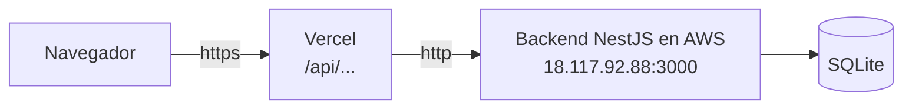

# Jave Parking — Frontend

Frontend de **Jave Parking**, la app del parqueadero de la **Pontificia Universidad Javeriana Cali**. Cada estudiante entra con su código, registra su carro, escoge un puesto libre en uno de los 3 parqueaderos (Principal, Almendros y Gualanday) y paga su salida por minuto con una tarifa fija. Aparte hay un área de administración. Se conecta al backend NestJS del proyecto.

**App en línea:** [https://jave-parking-frontend.vercel.app](https://jave-parking-frontend.vercel.app)
**Backend (repositorio):** [mateorivera2410/Jave-Parking](https://github.com/mateorivera2410/Jave-Parking)
**API en AWS:** [http://18.117.92.88:3000/users](http://18.117.92.88:3000/users)

Proyecto del curso **Plataformas Computacionales (2026-2)**.

## Integrantes

- Mateo Rivera Prados
- Diego Alejandro Calvo
- Jan Pieter Lelie
- Carlos Sánchez

## Tecnologías

| Tecnología | Para qué |
|---|---|
| **Next.js 16** (App Router) | Rutas, páginas y rutas dinámicas |
| **React 19** + **TypeScript** | Componentes tipados |
| **Tailwind CSS 4** | Estilos (diseño basado en el prototipo de Figma) |
| **fetch** nativo | Peticiones al backend, sin librerías extra |
| **Vercel** | Despliegue del frontend |

## Cómo se conecta con el backend



- El navegador nunca llama al backend directamente: le pide los datos a Vercel en `/api/...`.
- Vercel los reenvía al backend en AWS (configurado en `next.config.ts` con `rewrites`).
- Así se evita que el navegador bloquee la petición por mezclar **https** (Vercel) con **http** (AWS).
- En el computador (desarrollo), el front llama directo a `http://localhost:3000`.

## Pantallas

### App del estudiante

| Ruta | Pantalla | Qué hace |
|---|---|---|
| `/` | Iniciar sesión | Entra con su código estudiantil (solo números, de 6 a 10) |
| `/registro` | Crear cuenta | Código, nombre, correo, teléfono y la placa de su carro (opcional) |
| `/inicio` | Inicio | Si está parqueado, cuánto lleva; si no, los cupos libres de cada parqueadero |
| `/mapa` | Parqueaderos | Los 3 parqueaderos con sus cupos libres (Principal, Almendros, Gualanday) |
| `/mapa/[zona]` | Mapa | Puestos del parqueadero (verde = libre, rojo = ocupado). Toca uno libre y registra su entrada |
| `/pago` | Pago / Pago exitoso | Tiempo y total hasta ahora; paga y registra su salida |
| `/perfil` | Perfil | Sus datos, sus carros (agregar o quitar), su historial y cerrar sesión |

Solo ve **sus** carros y **sus** facturas. Las rutas del estudiante están en la carpeta `src/app/(estudiante)/`: los paréntesis agrupan rutas sin cambiar la URL.

### Administración (`/admin`)

| Ruta | Qué hace |
|---|---|
| `/admin/parqueaderos` | Los 3 parqueaderos con su mapa; agregar puestos, crear los que faltan, eliminar |
| `/admin/pagos` | Todas las facturas, registrar entradas y filtrar por placa |
| `/admin/carros` | Todos los carros con su dueño |
| `/admin/users` | Todos los usuarios; crear y desactivar |

Las carpetas con corchetes (`[zona]`, `[id]`, `[placa]`) son **rutas dinámicas**: el valor de la URL llega como parámetro a la página.

## Parqueaderos y tarifa

| Parqueadero | Puestos |
|---|---|
| A · Principal | 1 a 20 |
| B · Almendros | 21 a 40 |
| C · Gualanday | 41 a 60 |

- El backend guarda cada puesto con un número; el parqueadero al que pertenece se define por rangos en `src/modules/parqueaderos/zonas.ts`. Para agregar puestos o cambiar los rangos, solo se cambia ese archivo.
- La **tarifa es fija** para todos los puestos: **$3.000 por hora**, cobrada por minuto. Está en `src/lib/config.ts` (`TARIFA_HORA`). El estudiante no la puede cambiar.

## Flujo principal

1. El estudiante **crea su cuenta** (o inicia sesión con su código).
2. Registra su **carro** (la placa se puede escribir `ABC 123` o `abc123`).
3. Escoge un **parqueadero** y toca un **puesto libre** en el mapa: se crea la factura, el puesto queda ocupado y él queda "dentro".
4. En **Pago** ve cuánto lleva y **paga su salida**: el backend calcula el total por minuto, libera el puesto y lo marca "fuera".

## Estructura (por módulos y componentes)

```
src/
├── app/                         # Rutas (una carpeta = una ruta)
│   ├── layout.tsx               # Fuente, estilos y sesión del estudiante
│   ├── globals.css              # Colores del diseño (tokens de Tailwind)
│   ├── page.tsx                 # Iniciar sesión
│   ├── registro/                # Crear cuenta
│   ├── (estudiante)/            # inicio, mapa, mapa/[zona], pago, perfil (con sesión)
│   └── admin/                   # users, carros, parqueaderos, pagos (CRUD completo)
├── components/
│   ├── ui/                      # Piezas comunes: botones, tarjeta, placa, estado, íconos, formularios
│   ├── users/                   # UserCard, UserCreateForm, UserAvatar
│   ├── carros/                  # CarroCard, CarroCreateForm
│   ├── parqueaderos/            # ParqueaderoCard, ListaParqueaderos, DisponibilidadCard, filtros, formulario
│   ├── pagos/                   # PagoCard, PagoAbierto, PagoExitoso, PagoEntradaForm, PagoFilters
│   ├── estudiante/              # ParqueoActivoCard, AvisoSinCarro
│   ├── AppShell.tsx             # Header, menú y footer de cada área
│   ├── Nav.tsx                  # Menú del estudiante y del admin (arriba en computador, abajo en celular)
│   └── HomeShortcutCard.tsx
├── modules/                     # Services (el único lugar que habla con el backend), sesión y parqueaderos
│   ├── users/services/usersService.ts
│   ├── carros/services/carrosService.ts
│   ├── parqueaderos/services/parqueaderosService.ts
│   ├── pagos/services/pagosService.ts
│   ├── parqueaderos/zonas.ts    # Los 3 parqueaderos y sus rangos de puestos
│   └── session/                 # Sesión del estudiante (useSession): su usuario, carros y facturas
├── hooks/useEntityDetail.ts     # Carga reutilizable de un detalle por id
├── lib/
│   ├── api.ts                   # apiClient: fetch base + manejo de errores
│   ├── config.ts                # Tarifa fija y regla del código estudiantil
│   └── format.ts                # Formatos: pesos, horas, placa, duración
└── types/api.ts                 # Tipos (espejo de las entities del backend)
```

### Si algo falla, dónde buscar

| Si falla… | Se revisa |
|---|---|
| El backend responde error o la ruta está mal | `src/modules/<módulo>/services/` |
| Algo se ve mal (tarjeta, formulario, botón) | `src/components/<módulo>/` |
| La página no carga o no se actualiza | `src/app/<módulo>/page.tsx` |
| Un campo no coincide con el backend | `src/types/api.ts` |
| No conecta con el backend | `.env`, `next.config.ts` o `src/lib/api.ts` |
| Un color o un estilo de botón en toda la app | `src/app/globals.css` o `src/components/ui/buttons.ts` |
| El inicio de sesión o los datos del estudiante | `src/modules/session/` |
| A qué parqueadero pertenece un puesto | `src/modules/parqueaderos/zonas.ts` |

Cada página solo guarda el estado y llama al service. Las partes visuales son componentes que reciben los datos por *props* y avisan las acciones con *callbacks* (`onChange`, `onSubmit`, `onDelete`).

## Diseño

El diseño se basa en el prototipo navegable hecho en Figma (primera entrega):

| Color | Uso |
|---|---|
| `#142c6e` azul Javeriana | Headers, títulos y botones oscuros |
| `#ffc72c` amarillo | Botón principal y placas |
| `#35a55e` verde | Puesto libre / pagado |
| `#e04f4f` rojo | Puesto ocupado / eliminar |

Los colores están definidos una sola vez en `src/app/globals.css` y se usan como clases de Tailwind (`bg-jave-navy`, `text-jave-yellow`…). La fuente es **Inter** (`@fontsource-variable/inter`).

## Instalación y uso local

Requisitos: **Node.js 20+**, **Git** y el [backend](https://github.com/mateorivera2410/Jave-Parking) corriendo.

```bash
git clone https://github.com/mateorivera2410/Jave-Parking-Frontend.git
cd Jave-Parking-Frontend
npm install
echo "NEXT_PUBLIC_API_URL=http://localhost:3000" > .env
```

Se necesitan **dos terminales**:

```bash
# Terminal 1 — backend (en la carpeta del backend)
npm run start:dev          # http://localhost:3000

# Terminal 2 — frontend (en esta carpeta)
PORT=3001 npm run dev      # http://localhost:3001
```

El frontend usa el puerto **3001** porque el backend ya ocupa el 3000.

## Variables de entorno

| Variable | Local (`.env`) | Vercel | Para qué |
|---|---|---|---|
| `NEXT_PUBLIC_API_URL` | `http://localhost:3000` | `https://jave-parking-frontend.vercel.app/api` | A dónde le pide los datos el navegador |
| `BACKEND_URL` | — | `http://18.117.92.88:3000` | A dónde reenvía Vercel las peticiones de `/api` |

El archivo `.env` no se sube a GitHub (está en `.gitignore`).

## Comandos

| Comando | Qué hace |
|---|---|
| `npm run dev` | Corre la app en modo desarrollo |
| `npm run build` | Compila la app como en Vercel |
| `npm run start` | Corre la versión compilada |
| `npm run lint` | Revisa el código con ESLint |

## Despliegue en Vercel

1. Importar el repositorio en Vercel (**Add New → Project**).
2. Agregar las variables `BACKEND_URL` y `NEXT_PUBLIC_API_URL` (tabla de arriba).
3. **Deploy**.

Cada `git push` a `main` vuelve a publicar la app automáticamente.

## Limitaciones conocidas

- El estudiante entra **solo con su código** (el backend no maneja contraseñas): quien sepa un código puede entrar a esa cuenta.
- La sección `/admin` está separada pero **no tiene clave**.
- Los parqueaderos se definen por rangos en el frontend; el backend solo conoce el número del puesto.

## Créditos

Basado en [`frontend-nextjs-seed`](https://github.com/cdtello/frontend-nextjs-seed) del profesor del curso Plataformas Computacionales, adaptado a los módulos de Jave Parking (users, carros, parqueaderos y pagos).
